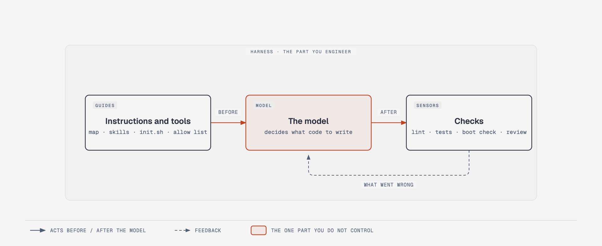
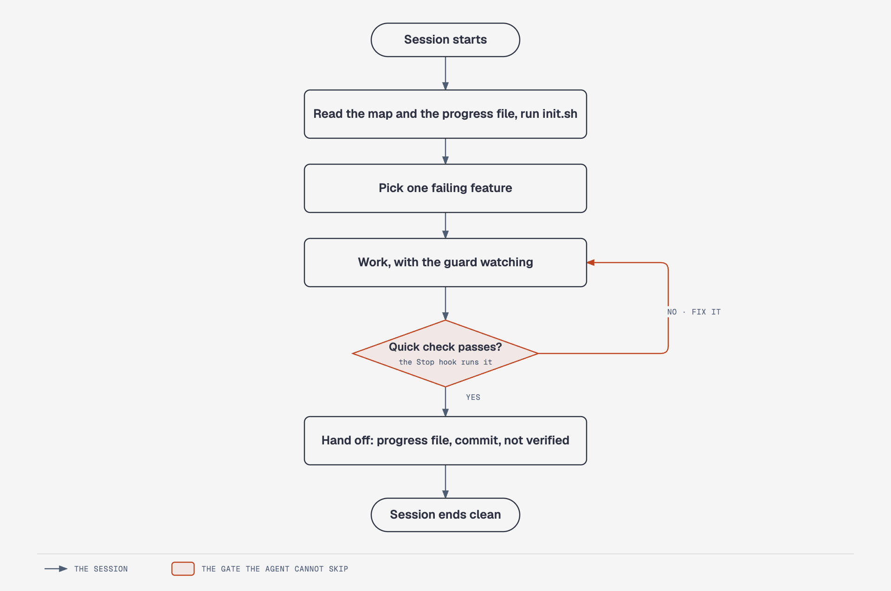
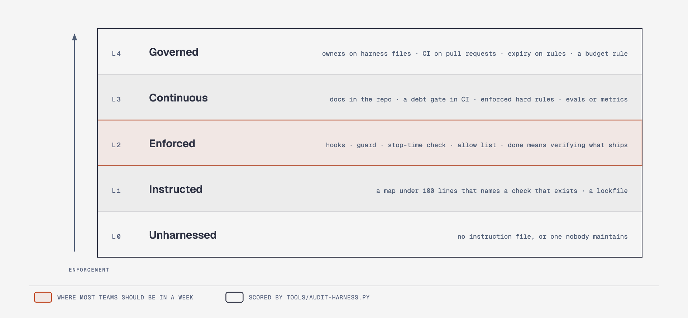
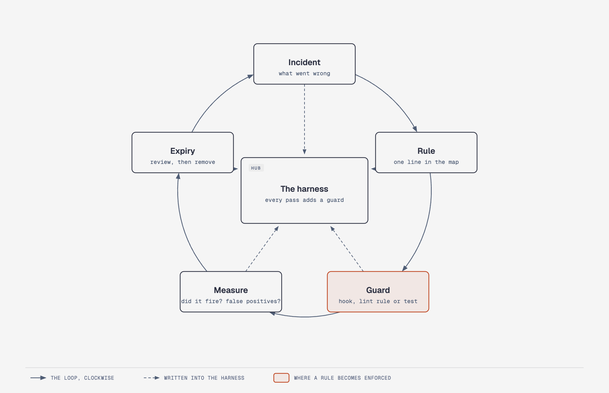

<p align="center">
  <picture>
    <source media="(prefers-color-scheme: dark)" srcset="assets/wordmark-dark.svg">
    
  </picture>
</p>

<p align="center"><strong>Harness engineering from 1 to production: the patterns, drop-in templates and enforcement gates that keep coding agents reliable in real repositories.</strong></p>

<p align="center">
  
  
  
  
  
</p>

## What's new: October 2026

0.1.1: the hooks' metrics log is now private, rotated and redacted; allowed commands are logged as a program name and a hash only (see [SECURITY](SECURITY.md)). First release, 0.1.0. Fourteen chapters, an eleven-file starter kit, a maturity audit that scores enforcement rather than file presence, hooks for Claude Code and Codex, an eval runner, and field lessons from running agents across six repositories of one product. See the [changelog](CHANGELOG.md).

## Table of contents

- [The one idea](#the-one-idea)
- [Quick start: the starter kit](#quick-start-the-starter-kit)
- [Learning path](#learning-path)
- [Chapters](#chapters)
- [A harnessed session](#a-harnessed-session)
- [Templates](#templates)
- [The maturity model and the audit](#the-maturity-model-and-the-audit)
- [How the harness learns](#how-the-harness-learns)
- [Who this is for](#who-this-is-for)
- [Repository structure](#repository-structure)

## The one idea

> The model decides what code to write. The harness decides everything else: what the model sees, what it may do, how it finds out it was wrong, what survives the session. Reliability lives in the second half.

<p align="center">
  <picture>
    <source media="(prefers-color-scheme: dark)" srcset="assets/model-and-harness-dark.png">
    
  </picture>
</p>

<details>
<summary>Text version</summary>

Inside the box labelled "Harness · the part you engineer" sit three nodes. **Guides** (the instruction map, skills, the init script, the allow list) act **before** the model. **The model** decides what code to write; it is the one part you do not control. **Sensors** (lint, tests, the boot check, review) act **after** it, and feed back what went wrong. Böckeler's warning is the whole discipline: sensors alone give an agent that repeats its mistakes, guides alone give one that never learns whether its rules worked.

</details>

The same model inside different harnesses scored between 68 % and 88 % on the same tasks; one harness-only change moved a benchmark 13.7 points; an unplayable application became a playable one at twenty times the cost. The numbers and their sources are in [chapter 1](docs/part-1-foundations/01-what-a-harness-is.md) and the [references](docs/references.md).

## Quick start: the starter kit

Eleven files take a repository to level 2 of the maturity model in one sitting:

```text
your-repo/
├── AGENTS.md                               the map: what this is, commands, done means, hard rules
├── CLAUDE.md                               one line: @AGENTS.md
├── scripts/quick-check.sh                  lint + types in under 90 s; the Stop hook runs it
├── scripts/check.sh                        the full check: tests, build, boot check
├── .claude/settings.json                   allow list for the checks; the four hooks below
├── .claude/hooks/guard-destructive.py      denies or asks before destructive commands and edits
├── .claude/hooks/require-check-before-stop.py   the agent cannot stop with a failing quick check
├── .claude/hooks/track-touched.py          remembers which files the session edited
├── .claude/hooks/session-start-context.py  branch, uncommitted count and the progress file at session start
├── docs/definition-of-done.md              what "done" means, including "not verified"
└── docs/PROGRESS.md                        the handoff between sessions
```

```sh
git clone https://github.com/ONA-AI-Labs/harness-engineering-playbook
cp -Rn harness-engineering-playbook/templates/starter/. your-repo/      # -n never overwrites a file you already have
# fill AGENTS.md, the commands at the top of scripts/quick-check.sh and scripts/check.sh, and the two placeholders in .claude/settings.json
# start a new agent session (hooks load at start), then score the repo:
python3 harness-engineering-playbook/tools/audit-harness.py your-repo
```

Or score any repository without cloning (read the script first; it is about 350 lines of standard-library Python):

```sh
curl -fsSL https://raw.githubusercontent.com/ONA-AI-Labs/harness-engineering-playbook/main/tools/audit-harness.py | python3 - /path/to/repo
```

Details in the [starter kit guide](templates/STARTER.md). Codex users: the same hooks ship as [`.codex/hooks.json`](templates/hooks/codex/hooks.json); copy the four scripts to `.codex/hooks/` as well, and note that Codex documents `deny` for a hook's decision while the guard's main tier is `ask` (see the [matrix](docs/tool-support-matrix.md)).

## Learning path

| Part | Chapters | Afterwards you can |
|---|---|---|
| 1 Foundations | 1 · 2 · 3 | explain the model-plus-harness split; write a map instead of an encyclopedia |
| 2 Control | 4 · 5 · 6 | turn repeated corrections into guards; stop "done" from meaning "tests passed" |
| 3 Continuity | 7 · 8 | hand work between sessions without loss; make the harness learn |
| 4 Scale | 9 · 10 · 11 · 12 | run several agents across several repos; prove a harness change helped |
| 5 Operate | 13 · 14 | prune what rots; roll the practice out across an organisation |

Thirty minutes: chapters 1, 4 and 5, then the starter kit. The full path: [Start here](docs/00-start-here.md).

## Chapters

| # | Question it answers | Core idea |
|---|---|---|
| [1](docs/part-1-foundations/01-what-a-harness-is.md) | Why do strong models still fail in real repos? | Agent = model + harness; guides before, sensors after; every component encodes an assumption |
| [2](docs/part-1-foundations/02-instruction-files.md) | Why does one giant instruction file fail? | A map under 100 lines with a Hard rules table that names each enforcer; detail moves to topic files |
| [3](docs/part-1-foundations/03-knowledge-in-the-repo.md) | If the agent cannot see it, does it exist? | The repository is the system of record: decisions, generated docs, versioned prompts, garbage collection |
| [4](docs/part-2-control/04-enforcement-over-prose.md) | Why are prose rules ignored? | Rule → script → hook; a destructive-command guard; the ratchet; source-reading architecture checks |
| [5](docs/part-2-control/05-verify-what-you-ship.md) | Why do agents declare victory early? | A definition of done that boots the built artifact; read the exit code; "not verified" is mandatory |
| [6](docs/part-2-control/06-permissions-and-consent.md) | How much autonomy, safely? | Allow exactly the checks; deny the irreversible; consent is explicit and never carries over |
| [7](docs/part-3-continuity/07-state-and-sessions.md) | Why do long tasks lose the thread? | Progress file, feature list, init script; one feature per session; a clean exit |
| [8](docs/part-3-continuity/08-memory-and-lessons.md) | How does the harness learn? | One file per lesson with the incident, the guard and an expiry; incident → rule → guard |
| [9](docs/part-4-scale/09-scope-and-delegation.md) | When should one agent become many? | The cheapest route; one agent per repo with a pasted contract; review opt-in |
| [10](docs/part-4-scale/10-loops-and-automation.md) | How do you stop prompting? | Maker-checker loops with budgets and kill switches; shadow mode; CI cost decisions written down |
| [11](docs/part-4-scale/11-evals.md) | How do you know a change helped? | 20–50 tasks from real failures; deterministic graders first; a calibrated judge with a negative control |
| [12](docs/part-4-scale/12-observability.md) | What should the harness measure? | Whether it fired, what it caught, what it cost; provenance stamps on every output |
| [13](docs/part-5-operate/13-maintaining-the-harness.md) | What rots, and how do you prune? | An incident and an expiry on every control; ablate one at a time; prose retires first |
| [14](docs/part-5-operate/14-enterprise-rollout.md) | How does an organisation adopt this? | The maturity model, owners, managed policy, a 30/60/90 plan, four numbers a month |

Then: [Field lessons](docs/field-lessons.md), the [tool support matrix](docs/tool-support-matrix.md), the [glossary](docs/glossary.md), the [references](docs/references.md).

## A harnessed session

<p align="center">
  <picture>
    <source media="(prefers-color-scheme: dark)" srcset="assets/session-lifecycle-dark.png">
    
  </picture>
</p>

<details>
<summary>Text version</summary>

1. The session starts. The agent reads the map and the progress file and runs `init.sh`.
2. It picks one failing feature from the feature list.
3. It works, with the guard watching every command.
4. When it wants to stop, the Stop hook runs the quick check. If the check fails, the agent fixes it and tries again (once; a repeated identical failure is let through with a note).
5. It hands off: progress file updated, a commit, and a list of what was not verified.

</details>

## Templates

Every template says where it goes and what it enforces. Scripts are tested in CI; placeholders look like `<THIS>`.

| Template | Drop where | What it enforces or provides |
|---|---|---|
| [`AGENTS.md`](templates/AGENTS.md), [`CLAUDE.md`](templates/CLAUDE.md) | repo root | the map: first ten lines, commands, done means, Hard rules with enforcers |
| [`scripts/quick-check.sh`](templates/scripts/quick-check.sh), [`check.sh`](templates/scripts/check.sh), [`boot-check.sh`](templates/scripts/boot-check.sh) | `scripts/` | lint and types in seconds; the full check; booting what you ship |
| [`scripts/ratchet.sh`](templates/scripts/ratchet.sh) | `scripts/` + CI | "no more than today" for pre-existing debt; a crashed checker never reads as clean |
| [`scripts/arch-check.py`](templates/scripts/arch-check.py) | `scripts/` + `.harness/arch-rules.json` | forbidden patterns per folder with WHAT / WHY / FIX messages |
| [`scripts/verify-feature.py`](templates/scripts/verify-feature.py), [`feature_list.json`](templates/feature_list.json) | repo root | the only way a feature becomes "done": its verify command, with evidence recorded |
| [`scripts/init.sh`](templates/scripts/init.sh), [`clean-state-check.sh`](templates/scripts/clean-state-check.sh) | `scripts/` | sessions start on a working machine and end clean |
| [`hooks/claude-code/settings.json`](templates/hooks/claude-code/settings.json), [`hooks/codex/hooks.json`](templates/hooks/codex/hooks.json) | `.claude/` or `.codex/` | the allow list and the four hooks |
| [`hooks/scripts/guard-destructive.py`](templates/hooks/scripts/guard-destructive.py) | `.claude/hooks/` | deny or ask before destructive commands and edits; fails open; logs every decision |
| [`hooks/scripts/require-check-before-stop.py`](templates/hooks/scripts/require-check-before-stop.py), [`track-touched.py`](templates/hooks/scripts/track-touched.py) | `.claude/hooks/` | the quick check runs in every repo the session touched before it may stop |
| [`hooks/scripts/session-start-context.py`](templates/hooks/scripts/session-start-context.py) | `.claude/hooks/` | branch, uncommitted count and the progress file arrive before the first prompt |
| [`docs/definition-of-done.md`](templates/docs/definition-of-done.md), [`PROGRESS.md`](templates/docs/PROGRESS.md), [`session-handoff.md`](templates/docs/session-handoff.md) | `docs/` | done means; the handoff between sessions |
| [`docs/ARCHITECTURE.md`](templates/docs/ARCHITECTURE.md), [`DECISIONS/`](templates/docs/DECISIONS/0001-record-architecture-decisions.md) | `docs/` | knowledge in the repository |
| [`docs/incident-to-rule.md`](templates/docs/incident-to-rule.md), [`rollout-runbook.md`](templates/docs/rollout-runbook.md), [`contract.md`](templates/docs/contract.md) | `docs/` | the learning loop; GO-gated rollouts; cross-repo contracts |
| [`agents/repo-agent.md`](templates/agents/repo-agent.md), [`contract-reviewer.md`](templates/agents/contract-reviewer.md) | `.claude/agents/` | one fenced agent per repository; an opt-in read-only reviewer |
| [`memory/`](templates/memory/MEMORY.md) | a memory folder | one lesson per file with rule, incident, how to apply, scope, expiry; an index of hooks |
| [`evals/`](templates/evals/run-evals.py) | `evals/` | tasks with verify commands, a runner, a judge rubric and schema, a comparer |
| [`ci/harness-gates.yml`](templates/ci/harness-gates.yml), [`PULL_REQUEST_TEMPLATE.md`](templates/PULL_REQUEST_TEMPLATE.md) | `.github/` | the same checks in CI; "verification evidence" and "not verified" in every pull request |

The [skill](skills/harness-playbook/SKILL.md) installs the missing pieces for the next level, one level at a time, without overwriting what a repository already has.

## The maturity model and the audit

<p align="center">
  <picture>
    <source media="(prefers-color-scheme: dark)" srcset="assets/maturity-ladder-dark.png">
    
  </picture>
</p>

| Level | A repository at this level has |
|---|---|
| 0 unharnessed | no instruction file, or one nobody maintains |
| 1 instructed | a map under 100 lines that says what the system is and names a check that exists; a lockfile |
| 2 enforced | hooks whose scripts exist; a destructive-command guard; a stop-time check; an allow list; a definition of done that verifies what ships |
| 3 continuous | knowledge docs in the repo; a debt gate in CI; hard rules with real enforcers; evals or a metrics log |
| 4 governed | owners on the harness files; CI on pull requests; an expiry on hard rules; a budget rule |

[`tools/audit-harness.py`](tools/audit-harness.py) scores a repository on these checks and prints what to do next. It checks enforcement (do the hook scripts exist, does the check command exist, does "done" boot what ships) rather than file presence, and a check that does not apply is declared with a reason, never skipped. `--min-level N` makes it a CI gate. [`tools/harness-stats.py`](tools/harness-stats.py) reads the metrics log the hooks write and answers "did the harness fire?".

## How the harness learns

<p align="center">
  <picture>
    <source media="(prefers-color-scheme: dark)" srcset="assets/incident-to-rule-dark.png">
    
  </picture>
</p>

An incident becomes a rule (one line in the map), the rule becomes a guard (a hook, a lint rule or a test), the guard is measured (did it fire? false positives?) and carries an expiry (review, then remove). Every pass writes into the harness. The [field lessons](docs/field-lessons.md) are 77 rules that came out of this loop, each with its generic incident and its guard where one exists.

## Who this is for

**For:** engineers and tech leads already running coding agents in real repositories; platform teams that own the developer experience; anyone who has watched an agent declare victory on a broken build.

**Not for:** a first introduction to coding agents; prompt-only workflows; teams that will not let agents into real repositories.

## Repository structure

```text
harness-engineering-playbook/
├── README.md
├── docs/
│   ├── 00-start-here.md
│   ├── part-1-foundations/ … part-5-operate/     the 14 chapters
│   ├── field-lessons.md · tool-support-matrix.md · glossary.md · references.md
├── templates/                                    copy into your repo (starter/ is the 11-file kit)
├── tools/                                        audit-harness.py · harness-stats.py · tests/ (bats)
├── skills/harness-playbook/                      the installer skill for Claude Code and Codex
├── assets/                                       diagrams (PNG, light and dark) and their sources
└── AGENTS.md · CLAUDE.md · Makefile              this repo's own harness: make quick runs from its Stop hook
```

This repository follows its own advice: `make quick` runs from the Stop hook, `make check` is the definition of done, `tools/tests/` covers every script and hook, and `tools/audit-harness.py .` scores it at level 3 with two declared exemptions. See [CONTRIBUTING](CONTRIBUTING.md), [SECURITY](SECURITY.md) and the [code of conduct](CODE_OF_CONDUCT.md).

## About

Maintained by [Ona AI Labs](https://github.com/ONA-AI-Labs). The field lessons come from running coding agents across one product's six repositories; they are written to be reused, not to tell that product's story. The vocabulary of editable harness components follows Google Research's [Harness²](https://github.com/google-research/harness2). MIT licensed. Cite it with the [citation file](CITATION.cff).
